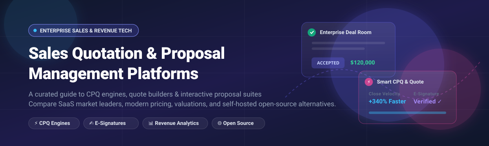

  

# 💼 Awesome Sales Quotation & Proposal Management

  
  
  
  
  
  

> 🚀 **A curated directory of top Sales Quotation, CPQ (Configure, Price, Quote), and Proposal Management platforms** — exploring leading SaaS commercial suites, company valuations, transparent pricing models, and self-hosted open-source alternatives designed to accelerate deal velocity and close contracts effortlessly.  
> 🌟 **Star this repository if you find it helpful!** 🌟

---

## 📑 Table of Contents

- [📈 Sector Overview & Market Dynamics](#-sector-overview--market-dynamics)
- [🏢 SaaS & Hosted Commercial Platforms](#-saas--hosted-commercial-platforms)
  - [SaaS Solutions Comparison Matrix](#-saas-solutions-comparison-matrix)
  - [Deep Dive: SaaS Market Leaders](#-deep-dive-saas-market-leaders)
- [💻 Open-Source Software Alternatives](#-open-source-software-alternatives)
  - [Open-Source Solutions Comparison Matrix](#-open-source-solutions-comparison-matrix)
  - [Deep Dive: Open-Source Tools](#-deep-dive-open-source-tools)
- [📊 Feature Comparison at a Glance](#-feature-comparison-at-a-glance)
- [⭐ Star History](#-star-history)
- [💖 Support & Sponsorship](#-support--sponsorship)
- [🤝 Contributing](#-contributing)
- [📄 License](#-license)

---

## 📈 Sector Overview & Market Dynamics

> The global **Sales Proposal Management & CPQ software market** is currently estimated between **$3.6 billion and $4.2 billion** (with the broader sales proposal automation space projected to exceed **$9 billion** by the late 2020s, growing at an annual CAGR of **11%–16%**).  
> The sector is **moderately fragmented**: enterprise CPQ and high-volume document generation gravitate toward established heavyweights (e.g., Conga, DealHub, and Salesforce ecosystem giants), while self-serve sales proposal and interactive quoting tools (such as PandaDoc, Qwilr, and Proposify) compete actively across mid-market and SMB segments where differentiation is driven by interactive deal rooms, speed to quote, and AI-assisted drafting.

---

## 🏢 SaaS & Hosted Commercial Platforms

Below is an overview of leading cloud-hosted sales proposal, CPQ, and quotation platforms. Companies are sorted in **descending order by company scale (valuation / annual recurring revenue)**.

### 📊 SaaS Solutions Comparison Matrix

| Platform 🏷️ | Scale (Valuation / Revenue) 💰 | Starting Tier Price 💳 | Free Tier / Free Trial Limits 🎁 | Key Focus & Deployment 🎯 |
|:---|:---:|:---:|:---:|:---|
| **[Conga Composer](https://conga.com/)** | **~$1.4B+ Valuation** (~$400M+ Annual Rev) | **$6** /user/month (AppExchange base) | **30-day free trial** with up to 10 user licenses in Salesforce org; no permanent free tier. | Enterprise document automation, Salesforce template generation, and contract lifecycle integration. |
| **[PandaDoc](https://www.pandadoc.com/)** | **~$1.0B Valuation** (~$100M+ ARR) | **$19** /user/month (billed annually) or $35/mo | **Free Tier:** 5 documents/month with unlimited e-signatures. **Free Trial:** 14-day trial of Business plan (no credit card). | End-to-end proposals, contracts, interactive pricing tables, and built-in e-signature. |
| **[DealHub](https://dealhub.io/)** | **~$350M–$500M Est. Val** ($184M+ Funded) | **$60** /user/month (annual contract basis) | **No permanent free tier & no self-serve free trial** (enterprise evaluation via guided sales demo/POC). | Agile enterprise CPQ, automated digital deal rooms, complex subscription billing, and multi-CRM syncing. |
| **[Qwilr](https://qwilr.com/)** | **~$80M–$100M Est. Val** (~$17.7M ARR) | **$35** /user/month (billed annually) or $49/mo | **14-day free trial** with Starter features (no credit card); expired trial proposals remain viewable for 30 days. | Interactive web-based proposals (HTML deal pages) with real-time quote calculators and QwilrPay. |
| **[Proposify](https://www.proposify.com/)** | **~$40M–$50M Est. Val** (~$8.0M ARR) | **$39** /user/month (billed annually) or $49/mo | **14-day free trial** on entry plan with core features (no credit card); no permanent free tier. | Design-centric sales proposals, branded client presentation portals, and approval workflows. |
| **[Better Proposals](https://betterproposals.io/)** | **~$5M–$8M Est. Val** (~$990K ARR) | **$13** /user/month (billed annually) or $19/mo | **14-day free trial** with full premium features (no credit card); Starter plan capped at 10 proposals/mo. | Lightweight proposal creation, freelance quote templates, speed-focused client acceptance, and payment gates. |

---

### 🔍 Deep Dive: SaaS Market Leaders

#### 1. [Conga Composer](https://conga.com/)
* **Scale:** ~$1.4B+ enterprise valuation footprint (merged under Thoma Bravo, bolstered by Apttus & PROS B2B acquisition; $400M+ revenue scale).
* **Pricing:** Starts at **$6/user/month** on Salesforce AppExchange (custom tailored based on document volumes and enterprise add-ons).
* **Trial / Free Tier:** **30-day free trial** with 10 user licenses in Salesforce environments; no permanent free tier.
* **Overview:** The enterprise industry standard for merging Salesforce records into quotes, proposals, and MS Word/PDF/PowerPoint presentations with fine-grained approval logic.

#### 2. [PandaDoc](https://www.pandadoc.com/)
* **Scale:** $1.0B Unicorn valuation (Series C); $100M+ Annual Recurring Revenue (ARR).
* **Pricing:** Starter plan starts at **$19/user/month** (annual) or $35/user/month (monthly); Business tier at $49/user/month.
* **Trial / Free Tier:** **Free Plan** includes 5 signed documents/month. Also provides a **14-day full free trial** with no credit card required.
* **Overview:** Comprehensive proposal management suite featuring drag-and-drop template editing, CRM pipelines, audit logs, and integrated checkout.

#### 3. [DealHub](https://dealhub.io/)
* **Scale:** Over $184M raised through Series D led by Riverwood Capital; estimated valuation ~$350M–$500M.
* **Pricing:** Starts at approx **$60/user/month** (annual agreement; median mid-market ACV typically ~$44,000/year).
* **Trial / Free Tier:** **No free trial** or freemium tier; delivered exclusively via enterprise consultation and custom sandbox proof-of-concept.
* **Overview:** Modern Configure, Price, Quote (CPQ) solution powering hybrid sales motions (consumption, subscriptions, services) through interactive deal rooms.

#### 4. [Qwilr](https://qwilr.com/)
* **Scale:** $8.9M VC funding (Series A led by AirTree & Point Nine); ~$17.7M ARR estimate.
* **Pricing:** Starter tier begins at **$35/user/month** (annual) or $49/user/month (monthly); Growth tier at $55/user/month (min 5 seats).
* **Trial / Free Tier:** **14-day free trial** without credit card; proposals created during trial remain accessible to buyers for 30 days.
* **Overview:** Replaces static PDF proposals with interactive, responsive web experiences featuring dynamic product configuration tables and instant online signatures.

#### 5. [Proposify](https://www.proposify.com/)
* **Scale:** $13M total capital raised; ~$8.0M ARR estimate.
* **Pricing:** Basic tier starts at **$39/user/month** (annual) or $49/user/month (monthly); Team tiers at $65/user/month.
* **Trial / Free Tier:** **14-day free trial** granting access to core document creation and signature features; no credit card required.
* **Overview:** Polished document design software equipped with modular content libraries, layout control, and real-time viewing metrics.

#### 6. [Better Proposals](https://betterproposals.io/)
* **Scale:** Bootstrapped SaaS operation; ~$990K ARR estimate.
* **Pricing:** Starter begins at **$13/user/month** (billed annually) or $19/user/month (monthly), capped at 10 sent proposals per month.
* **Trial / Free Tier:** **14-day free trial** with unmetered access to explore premium proposal templates; no credit card required.
* **Overview:** Streamlined, easy-to-use proposal generator designed for agencies and freelancers seeking rapid deal closes without heavy enterprise setup.

---

## 💻 Open-Source Software Alternatives

Below is a curated selection of self-hosted open-source proposal engines, CPQ toolkits, and quotation managers. Repositories are **sorted in descending order by GitHub Stars_Count**, featuring a live social Stars_Badge linking directly to each repository's stargazers page.

### 📊 Open-Source Solutions Comparison Matrix

| Project Name 📦 | GitHub_Stars ⭐ | Tech Stack 🛠️ | License 📜 | Quoting & Proposal Focus 🎯 |
|:---|:---:|:---|:---:|:---|
| **[DocuSeal](https://github.com/docusealco/docuseal)** |  | Ruby on Rails, Vue.js, PostgreSQL | AGPL-3.0 | Open-source document creation, contract templates, fillable PDF forms, and digital signing. |
| **[Documenso](https://github.com/documenso/documenso)** |  | Next.js, TypeScript, Prisma, Tailwind | AGPL-3.0 | Next-generation open-source signing infrastructure and document verification suite. |
| **[Invoice Ninja](https://github.com/invoiceninja/invoiceninja)** |  | PHP (Laravel), Flutter, MySQL | Elastic-2.0 | Complete sales quoting, quote-to-invoice conversion, client portal, and payment processing. |
| **[Crater](https://github.com/crater-invoice-inc/crater)** |  | PHP (Laravel), Vue.js, Docker | Open Source | Modern self-hosted estimate and quotation builder with multi-currency and PDF dispatch. |
| **[Invoice & Quotation Builder](https://github.com/piratuks/invoice-builder)** |  | Electron, JavaScript, SQLite, HTML5 | MIT | Desktop-native quotation and invoice manager with offline database and instant PDF export. |
| **[Open Agents Builder (CPQ)](https://github.com/CatchTheTornado/open-agents-builder)** |  | TypeScript, Node.js, AI Agents | Apache-2.0 | AI business agent workflow platform featuring automated CPQ intake and quote rules. |
| **[Odoo Product Configurator](https://github.com/pledra/odoo-product-configurator)** |  | Python, Odoo ERP framework | AGPL-3.0 | Dynamic product configuration and CPQ pricing rule engine integrated with ERP sales quotes. |
| **[openCPQ](https://github.com/webXcerpt/openCPQ)** |  | JavaScript, Web Standards | MIT | In-browser product configuration engine for complex pricing calculations and quotes. |
| **[Oreko](https://github.com/orekoapp/oreko)** |  | Next.js, TypeScript, PostgreSQL, Stripe | AGPL-3.0 | Block-based visual quote builder with 1-click quote-to-invoice conversion and e-signatures. |
| **[SwiftCPQ](https://github.com/christopher-talke/SwiftCPQ)** |  | Vue.js, JavaScript, Docker | AGPL-3.0 | Self-hosted CPQ and proposal builder for Managed Service Providers (MSPs) and IT consultants. |
| **[Core OSS](https://github.com/michellzappa/core-oss)** |  | Next.js, Supabase, Tailwind, TypeScript | MIT | Minimalist CRM with built-in Offer Builder and public shareable proposal acceptance pages. |
| **[Quote and Sign](https://github.com/quoteandsign/quoteandsign)** |  | TypeScript, Cloudflare Workers/Pages | AGPL-3.0 | Phone-optimized interactive proposals with real-time price toggles and SHA-256 acceptance proofs. |
| **[PactPop](https://github.com/Debb1ie/PactPop)** |  | Next.js, Drizzle, PostgreSQL, PayPal | MIT | AI multi-agent agreement platform handling client proposals, scope checks, and deposits. |

---

### 🔍 Deep Dive: Open-Source Tools

#### 1. [DocuSeal](https://github.com/docusealco/docuseal) 
* **Stack:** Ruby on Rails / Vue.js / PostgreSQL | **License:** AGPL-3.0
* **Highlights:** High-volume document creation and legally binding signature workflows. Allows businesses to design reusable proposal contracts with customizable fields and automated email notifications.
* **Best for:** Teams needing self-hosted document signing and contract closure without per-envelope fees.

#### 2. [Documenso](https://github.com/documenso/documenso) 
* **Stack:** Next.js / TypeScript / Prisma / Tailwind | **License:** AGPL-3.0
* **Highlights:** Modern TypeScript-first signing platform designed to be embedded into custom web applications and CRM pipelines with cryptographic document seals.
* **Best for:** Developers looking to build custom proposal signing experiences natively into their own SaaS products.

#### 3. [Invoice Ninja](https://github.com/invoiceninja/invoiceninja) 
* **Stack:** PHP (Laravel) / Flutter / MySQL | **License:** Elastic-2.0
* **Highlights:** Robust quote-to-cash workflow system. Users can draft branded sales quotations, deliver them to a dedicated client portal for digital approval, and automatically transform accepted quotes into active invoices.
* **Best for:** Businesses and freelancers wanting a battle-tested quotation management and billing system with multi-currency support.

#### 4. [Crater](https://github.com/crater-invoice-inc/crater) 
* **Stack:** PHP (Laravel) / Vue.js / Docker | **License:** Open Source
* **Highlights:** Clean and minimalistic estimate/quotation creator. Enables custom tax rates, payment terms, and downloadable PDF quotes delivered straight to clients.
* **Best for:** Small businesses requiring self-hosted estimation and quote delivery without complex enterprise bloat.

#### 5. [Invoice & Quotation Builder](https://github.com/piratuks/invoice-builder) 
* **Stack:** Electron / JavaScript / SQLite | **License:** MIT
* **Highlights:** Fully offline desktop application that stores quotation data in a local database. Supports fast PDF generation, client records, and itemized service templates.
* **Best for:** Freelancers and local service providers wanting full privacy and zero cloud dependencies for sales quoting.

#### 6. [Open Agents Builder (CPQ)](https://github.com/CatchTheTornado/open-agents-builder) 
* **Stack:** TypeScript / Node.js | **License:** Apache-2.0
* **Highlights:** An agentic framework that connects customer intake forms and product catalogs to generate accurate CPQ quotations automatically.
* **Best for:** Engineering teams building AI-powered automated quotation funnels.

#### 7. [Odoo Product Configurator](https://github.com/pledra/odoo-product-configurator) 
* **Stack:** Python / Odoo ERP | **License:** AGPL-3.0
* **Highlights:** Comprehensive product configuration module for Odoo sales orders. Implements dynamic rule-based pricing and custom assembly configurations for complex manufactured goods.
* **Best for:** Manufacturing and B2B distributor teams running Odoo requiring CPQ capabilities.

#### 8. [openCPQ](https://github.com/webXcerpt/openCPQ) 
* **Stack:** JavaScript / HTML5 | **License:** MIT
* **Highlights:** Client-side JavaScript toolkit allowing web applications to calculate complex multi-attribute pricing formulas dynamically within the browser.
* **Best for:** Front-end developers building interactive custom price calculators for sales reps.

#### 9. [Oreko](https://github.com/orekoapp/oreko) 
* **Stack:** TypeScript / Next.js / PostgreSQL / Stripe | **License:** AGPL-3.0
* **Highlights:** Modern block-based quotation builder inspired by Notion and Linear. Features one-click quote-to-invoice transitions, milestone payments, Stripe checkout, and e-signatures.
* **Best for:** Creative agencies and solo professionals seeking an open alternative to HoneyBook, Bonsai, or Bloom.

#### 10. [SwiftCPQ](https://github.com/christopher-talke/SwiftCPQ) 
* **Stack:** Vue.js / Docker | **License:** AGPL-3.0
* **Highlights:** Tailored for Managed Service Providers (MSPs) and tech consultancies. Manages recurring hardware and service line items with margin and discount calculators.
* **Best for:** IT consultants looking for an open alternative to ConnectWise CPQ or Scalepad Quoter.

#### 11. [Core OSS](https://github.com/michellzappa/core-oss) 
* **Stack:** Next.js / Supabase / Tailwind / TypeScript | **License:** MIT
* **Highlights:** Lightweight CRM incorporating an Offer Builder with shareable public web links, email-verified acceptance, and real-time deal conversion tracking.
* **Best for:** Developers building modular agency workflows with AI-assisted code tools like Claude Code.

#### 12. [Quote and Sign](https://github.com/quoteandsign/quoteandsign) 
* **Stack:** TypeScript / Cloudflare Pages & Workers | **License:** AGPL-3.0
* **Highlights:** Edge-deployed web proposals that recipients can interact with directly on mobile screens. Features dynamic item toggles, live recalculations, and cryptographic SHA-256 acceptance receipts.
* **Best for:** Studios and freelancers wanting lightweight, interactive proposals hosted on serverless infrastructure.

#### 13. [PactPop](https://github.com/Debb1ie/PactPop) 
* **Stack:** Next.js / Drizzle / PostgreSQL / PayPal | **License:** MIT
* **Highlights:** Multi-agent autonomous sales assistant that tracks client negotiations, flags scope creep, authors proposals, and coordinates deposit invoices via PayPal.
* **Best for:** Freelancers and consultants exploring agentic automation in commercial client onboarding.

---

## 📊 Feature Comparison at a Glance

| Software Solution 💻 | License Type 📜 | Deployment ☁️ | Dynamic Quoting ⚡ | E-Signature ✍️ | Interactive Client Portal 📱 | Primary Target Audience 🎯 |
|:---|:---:|:---:|:---:|:---:|:---:|:---|
| **Conga Composer** | Commercial | Salesforce Cloud | ✅ Complex Rules | ✅ Add-on | ✅ Custom Communities | Enterprise Salesforce Organizations |
| **PandaDoc** | Commercial | Cloud SaaS | ✅ Custom Tables | ✅ Legally Binding | ✅ Deal Rooms | Mid-Market & Enterprise Sales Teams |
| **DealHub** | Commercial | Cloud SaaS | ✅ Advanced CPQ | ✅ Built-in | ✅ DealRoom Suite | High-Velocity B2B & SaaS Sales Orgs |
| **Qwilr** | Commercial | Cloud SaaS | ✅ Interactive Pricing | ✅ Built-in | ✅ Web Page Proposals | Modern Sales Reps & Agencies |
| **Proposify** | Commercial | Cloud SaaS | ✅ Template Tables | ✅ Built-in | ✅ Client Viewers | Design-Conscious Sales Teams |
| **Better Proposals** | Commercial | Cloud SaaS | ✅ Simple Tables | ✅ Built-in | ✅ Web View | Solo Creators, Agencies & Small Businesses |
| **DocuSeal** | Open Source (AGPL-3.0) | Self-Hosted / Docker | ⚠️ Contract Forms | ✅ Complete Suite | ✅ Signer Flow | Self-Hosters Needing Contract Signing |
| **Invoice Ninja** | Open Source (Elastic-2.0) | Self-Hosted / Cloud | ✅ Full Line Items | ✅ Portal Approval | ✅ Client Portal | Businesses Needing Quote-to-Invoice Workflows |
| **Oreko** | Open Source (AGPL-3.0) | Self-Hosted / Docker | ✅ Block-Based | ✅ Built-in | ✅ Customer Dashboard | Freelancers, Studios & Agencies |
| **SwiftCPQ** | Open Source (AGPL-3.0) | Self-Hosted | ✅ Margin & Recurring | ⏳ Roadmap | ⏳ Roadmap | MSPs & IT Service Providers |
| **Quote and Sign** | Open Source (AGPL-3.0) | Self-Hosted / Cloudflare | ✅ Dynamic Quantities | ✅ SHA-256 Verify | ✅ Mobile Link | Solo Agencies & Freelancers |

---

## ⭐ Star History

---

## 💖 Support & Sponsorship

Thank you so much for exploring and using this curated list! Maintaining and keeping this repository accurate, up-to-date with current pricing, valuations, and new open-source discoveries takes time and passion.

If you found this resource helpful for your team, business, or workflow, please consider supporting the project:

- ⭐ **Star** this repository to help others discover it on GitHub.
- 🍴 **Fork** and share it with fellow developers, sales engineers, and founders.
- 📢 **Spread the word** on Twitter/X, LinkedIn, or relevant tech communities.
- ☕ **Buy me a coffee / Sponsor**: If you'd like to support ongoing development and maintenance directly, visit my **[GitHub Sponsors Dashboard](https://github.com/sponsors/ishandutta2007)**. Every bit of support is deeply appreciated!

---

## 🤝 Contributing

Contributions are warmly encouraged! If you know of an outstanding open-source project or platform dedicated to sales quotations, CPQ, or proposal automation that should be featured here:

1. 🍴 **Fork** the repository.
2. 🌿 Create a descriptive feature branch (`git checkout -b add-my-tool`).
3. 📝 Add the tool details following our format (Name, URL, Stack, License, Stars_Badge, and unique value proposition).
4. 🚀 Submit a **Pull Request** with a brief summary of the project.

---

## 📄 License

This repository and curated list are released into the public domain under [CC0 1.0 Universal](LICENSE). All referenced trademarks, logos, and software products belong to their respective copyright holders.

---

  ⭐ <b>Found this curated guide valuable? Please consider starring the repository to support ongoing maintenance!</b> ⭐

